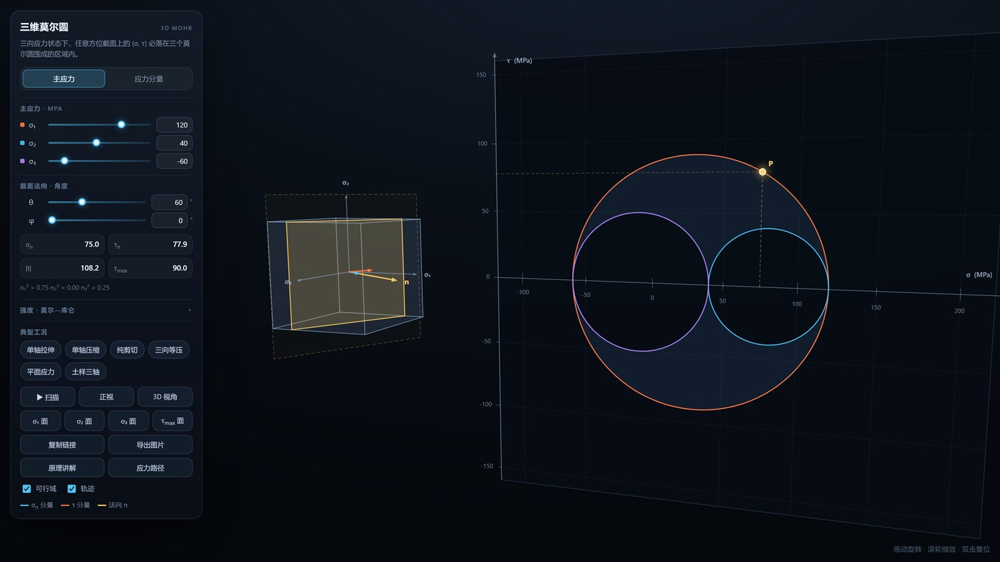

# 三维莫尔圆 · 交互演示

一个单文件、零依赖的可交互莫尔圆：转动任意方位的截面，实时看到 (σ, τ) 落在三个莫尔圆围成的可行域里。



## 在线使用

**https://yunstar111.github.io/mohr-circle/** ← 手机、电脑都能直接打开

或者下载 `index.html` 双击打开——不需要联网，不需要安装任何东西。

## 它能做什么

| 模块 | 说明 |
|---|---|
| **三维应力单元体** | 立方体上画出主方向、截面法向、法向应力分量与剪应力分量 |
| **三圆可行域** | 三个莫尔圆围成的区域，即所有可能截面上 (σ, τ) 的集合 |
| **任意截面** | θ、φ 两个角度控制法向，点 P 实时跟随 |
| **两种输入** | 直接给主应力，或给 σx σy σz τxy τyz τzx 六个分量 |
| **主应力求解** | 雅可比旋转做 3×3 对称阵特征分解，得到主应力与主方向 |
| **莫尔–库仑强度** | 强度包线 τf = c + σ·tanφ、切点、安全系数 Fs、破坏面角度 |
| **典型工况** | 单轴拉伸/压缩、纯剪切、三向等压、平面应力、土样三轴，一键切换 |
| **应力路径** | p–q 平面记录加载路径，可自动加载看何时撞上包线 |
| **原理讲解** | 内置 8 节推导讲义：斜截面平衡 → 消参得圆 → 二倍角 → 三维三圆 → 库仑强度 → 特征值 |
| **导出** | 一键导出带参数卡片的 PNG；链接可带参数分享当前状态 |

## 背后的公式

主应力坐标系下取单位法向 **n**：

```
σn = σ1·n1² + σ2·n2² + σ3·n3²
τn² = σ1²·n1² + σ2²·n2² + σ3²·n3² − σn²
```

n 取遍所有方向时，(σn, τn) 填满三个圆之间的区域；某个 nᵢ = 0 时点落在对应的圆上。

强度包线（本图 σ 以拉为正，故斜率显示为负）：

```
τf = c − σ·tanφ        Fs = (c·cosφ − C·sinφ) / R
```

## 操作

| 电脑 | 手机 |
|---|---|
| 拖动旋转 · 滚轮缩放 · 双击复位 | 单指旋转 · 双指缩放 |
| 左侧面板调参数 | 底部「参数」条展开收起 |
| 数字框可直接键入，回车确认 | 滑块点按拖动 |

## 技术说明

- 单个 HTML 文件，约 65 KB，不依赖任何 CDN / 框架 / 字体文件
- 3D 渲染是自己写的：向量运算 + 透视投影 + 画家算法排序，用 Canvas 2D 画出来
- 响应式：桌面左侧面板，手机底部抽屉，横屏自动左右排布
- 离线可用，直接双击 `index.html` 即可

## 兼容性

Chrome / Edge / Firefox / Safari 现代版本。手机端建议用系统浏览器打开，不要用文件管理器的内置预览（对 CSS 和触摸事件支持不全）。
